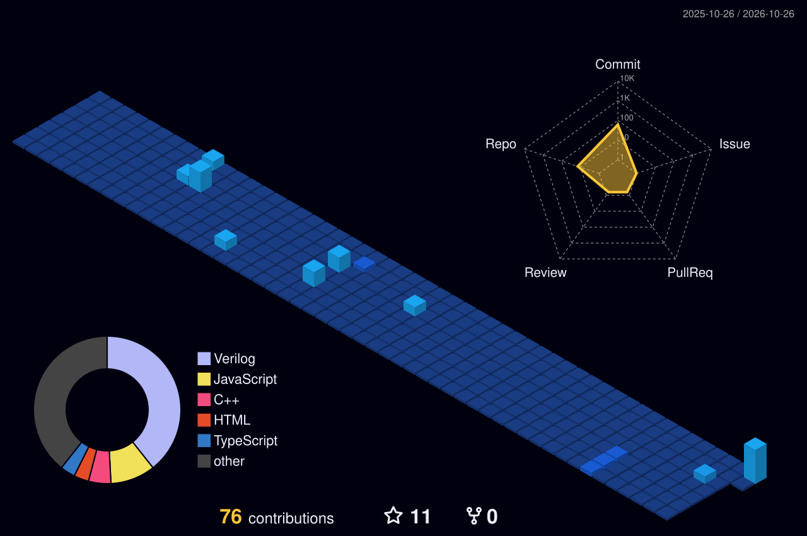

<!-- ===================== HEADER ===================== -->

  

---

## 👨‍🚀 About Me

---

## 🛠️ Tech Stack

<h4>⚡ Hardware & VLSI (Core)</h4>

<h4>📚 Currently Learning</h4>

<h4>💻 Programming</h4>
<table>
<tr><td align="center" width="96"> <b>C</b></td><td align="center" width="96"> <b>C++</b></td><td align="center" width="96"> <b>Python</b></td><td align="center" width="96"> <b>Java</b></td><td align="center" width="96"> <b>JavaScript</b></td></tr>
</table>

<h4>🌐 Web Development</h4>
<table>
<tr><td align="center" width="96"> <b>HTML5</b></td><td align="center" width="96"> <b>CSS3</b></td><td align="center" width="96"> <b>React</b></td><td align="center" width="96"> <b>Node.js</b></td></tr>
</table>

<h4>🤖 Vision & AI</h4>
<table>
<tr><td align="center" width="96"> <b>OpenCV</b></td><td align="center" width="96"> <b>PyTorch</b></td><td align="center" width="96"> <b>TensorFlow</b></td></tr>
</table>

<h4>🔌 Embedded</h4>
<table>
<tr><td align="center" width="96"> <b>Arduino</b></td></tr>
</table>

<h4>🗄️ Databases & Cloud</h4>
<table>
<tr><td align="center" width="96"> <b>MySQL</b></td><td align="center" width="96"> <b>MongoDB</b></td><td align="center" width="96"> <b>Firebase</b></td></tr>
</table>

<h4>🧰 Tools & Platforms</h4>
<table>
<tr><td align="center" width="96"> <b>Git</b></td><td align="center" width="96"> <b>Linux</b></td><td align="center" width="96"> <b>Docker</b></td><td align="center" width="96"> <b>Figma</b></td></tr>
</table>

---

## 🚀 Featured Projects

<!--
  ADD MORE PROJECTS: copy the block above and replace the repo name
  (it must match your repository name exactly):

  
-->

| Project | What it does | Stack |
|:--|:--|:--|
| [**Sobel Edge Detection on FPGA**](https://github.com/itsmeGaurav07/Hardware-Accelerated-Sobel-Edge-Detection-on-FPGA) | Real-time, hardware-accelerated Sobel edge detection for FPGA-based image processing | `Verilog` `FPGA` `Image Processing` |

👉 More projects: **[github.com/itsmeGaurav07?tab=repositories](https://github.com/itsmeGaurav07?tab=repositories)**

---

## 📊 GitHub Analytics

 

---

## 🌌 Contribution Activity

<!-- Snake animation: generated by .github/workflows/snake.yml -->
<picture>
  <source media="(prefers-color-scheme: dark)" srcset="https://raw.githubusercontent.com/itsmeGaurav07/itsmeGaurav07/output/github-snake-dark.svg"/>
  <source media="(prefers-color-scheme: light)" srcset="https://raw.githubusercontent.com/itsmeGaurav07/itsmeGaurav07/output/github-snake.svg"/>
  
</picture>

<!--
  OPTIONAL 3D CONTRIBUTION GRAPH
  Enable it only after the "Generate 3D Contribution Graph" workflow has run
  successfully and the file profile-3d-contrib/profile-night-view.svg exists in your repo.
  Then remove the comment markers around the image below.

    
  
-->

---

## 🤝 Connect With Me

  

⭐ If you like my work, drop a star on a repo. Thanks for stopping by!

